<br />
<p align="center">

</p>
</br>
<p align="center">
    A collection of Open Source charts and utility components that you can customize and extend.
    <br />
    <br />
    <a href="https://github.com/bklit/bklit-ui"></a>
    <a href="https://github.com/bklit/bklit-ui/actions"></a>
    <a href="https://discord.gg/75s4frfE8X"></a>
    <a href="https://x.com/uixmat"></a>
    <a href="https://vercel.com/oss"></a>
  </p>
</p>


## Sponsors

Bklit UI is supported by our sponsors. [Become a sponsor](https://github.com/sponsors/uixmat).

**Premium sponsors:** [OpenPanel](https://openpanel.dev)

<a href="https://openpanel.dev">

</a>

**[OpenPanel](https://openpanel.dev)** — OpenPanel is an open source analytics platform that combines web analytics and product analytics in one privacy-first tool. Track pageviews, events, funnels, retention, and user journeys — all without cookies.

**Silver sponsors:** [UI Rules](https://uirules.com), [shadcn studio](https://shadcnstudio.com), [pug](https://pug.sh)

## Charts

<table>
  <tr>
    <td align="center" valign="top" width="33%">
      <a href="https://ui.bklit.com/docs/components/area-chart">
        <picture>
          <source media="(prefers-color-scheme: dark)" srcset="apps/web/public/readme/area-chart-dark.svg" />
          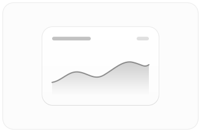
        </picture>
      </a>
      <br />
      <strong>Area Chart</strong><br />
      <a href="https://ui.bklit.com/docs/components/area-chart">Docs</a> · <a href="https://ui.bklit.com/studio?chart=area-chart">Studio</a>
    </td>
    <td align="center" valign="top" width="33%">
      <a href="https://ui.bklit.com/docs/components/bar-chart">
        <picture>
          <source media="(prefers-color-scheme: dark)" srcset="apps/web/public/readme/bar-chart-dark.svg" />
          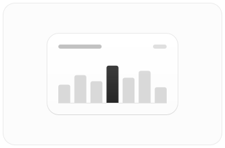
        </picture>
      </a>
      <br />
      <strong>Bar Chart</strong><br />
      <a href="https://ui.bklit.com/docs/components/bar-chart">Docs</a> · <a href="https://ui.bklit.com/studio?chart=bar-chart">Studio</a>
    </td>
    <td align="center" valign="top" width="33%">
      <a href="https://ui.bklit.com/docs/components/candlestick-chart">
        <picture>
          <source media="(prefers-color-scheme: dark)" srcset="apps/web/public/readme/candlestick-chart-dark.svg" />
          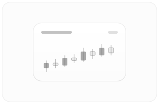
        </picture>
      </a>
      <br />
      <strong>Candlestick Chart</strong><br />
      <a href="https://ui.bklit.com/docs/components/candlestick-chart">Docs</a> · <a href="https://ui.bklit.com/studio?chart=candlestick-chart">Studio</a>
    </td>
  </tr>
  <tr>
    <td align="center" valign="top" width="33%">
      <a href="https://ui.bklit.com/docs/components/choropleth-chart">
        <picture>
          <source media="(prefers-color-scheme: dark)" srcset="apps/web/public/readme/choropleth-chart-dark.svg" />
          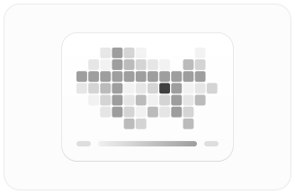
        </picture>
      </a>
      <br />
      <strong>Choropleth Chart</strong><br />
      <a href="https://ui.bklit.com/docs/components/choropleth-chart">Docs</a> · <a href="https://ui.bklit.com/studio?chart=choropleth-chart">Studio</a>
    </td>
    <td align="center" valign="top" width="33%">
      <a href="https://ui.bklit.com/docs/components/composed-chart">
        <picture>
          <source media="(prefers-color-scheme: dark)" srcset="apps/web/public/readme/composed-chart-dark.svg" />
          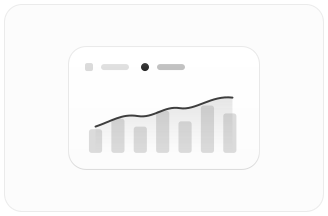
        </picture>
      </a>
      <br />
      <strong>Composed Chart</strong><br />
      <a href="https://ui.bklit.com/docs/components/composed-chart">Docs</a> · <a href="https://ui.bklit.com/studio?chart=composed-chart">Studio</a>
    </td>
    <td align="center" valign="top" width="33%">
      <a href="https://ui.bklit.com/docs/components/funnel-chart">
        <picture>
          <source media="(prefers-color-scheme: dark)" srcset="apps/web/public/readme/funnel-chart-dark.svg" />
          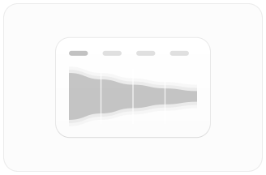
        </picture>
      </a>
      <br />
      <strong>Funnel Chart</strong><br />
      <a href="https://ui.bklit.com/docs/components/funnel-chart">Docs</a> · <a href="https://ui.bklit.com/studio?chart=funnel-chart">Studio</a>
    </td>
  </tr>
  <tr>
    <td align="center" valign="top" width="33%">
      <a href="https://ui.bklit.com/docs/components/gauge-chart">
        <picture>
          <source media="(prefers-color-scheme: dark)" srcset="apps/web/public/readme/gauge-chart-dark.svg" />
          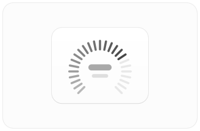
        </picture>
      </a>
      <br />
      <strong>Gauge</strong><br />
      <a href="https://ui.bklit.com/docs/components/gauge-chart">Docs</a> · <a href="https://ui.bklit.com/studio?chart=gauge-chart">Studio</a>
    </td>
    <td align="center" valign="top" width="33%">
      <a href="https://ui.bklit.com/docs/components/heatmap-chart">
        <picture>
          <source media="(prefers-color-scheme: dark)" srcset="apps/web/public/readme/heatmap-chart-dark.svg" />
          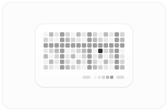
        </picture>
      </a>
      <br />
      <strong>Heatmap Chart</strong><br />
      <a href="https://ui.bklit.com/docs/components/heatmap-chart">Docs</a> · <a href="https://ui.bklit.com/studio?chart=heatmap-chart">Studio</a>
    </td>
    <td align="center" valign="top" width="33%">
      <a href="https://ui.bklit.com/docs/components/line-chart">
        <picture>
          <source media="(prefers-color-scheme: dark)" srcset="apps/web/public/readme/line-chart-dark.svg" />
          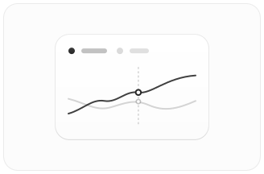
        </picture>
      </a>
      <br />
      <strong>Line Chart</strong><br />
      <a href="https://ui.bklit.com/docs/components/line-chart">Docs</a> · <a href="https://ui.bklit.com/studio?chart=line-chart">Studio</a>
    </td>
  </tr>
  <tr>
    <td align="center" valign="top" width="33%">
      <a href="https://ui.bklit.com/docs/components/live-line-chart">
        <picture>
          <source media="(prefers-color-scheme: dark)" srcset="apps/web/public/readme/live-line-chart-dark.svg" />
          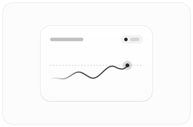
        </picture>
      </a>
      <br />
      <strong>Live Line Chart</strong><br />
      <a href="https://ui.bklit.com/docs/components/live-line-chart">Docs</a> · <a href="https://ui.bklit.com/studio?chart=live-line-chart">Studio</a>
    </td>
    <td align="center" valign="top" width="33%">
      <a href="https://ui.bklit.com/docs/components/pie-chart">
        <picture>
          <source media="(prefers-color-scheme: dark)" srcset="apps/web/public/readme/pie-chart-dark.svg" />
          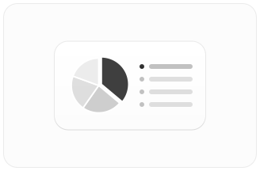
        </picture>
      </a>
      <br />
      <strong>Pie Chart</strong><br />
      <a href="https://ui.bklit.com/docs/components/pie-chart">Docs</a> · <a href="https://ui.bklit.com/studio?chart=pie-chart">Studio</a>
    </td>
    <td align="center" valign="top" width="33%">
      <a href="https://ui.bklit.com/docs/components/profit-loss-line">
        <picture>
          <source media="(prefers-color-scheme: dark)" srcset="apps/web/public/readme/profit-loss-line-dark.svg" />
          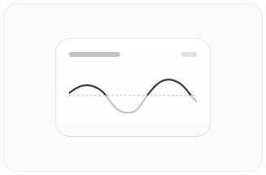
        </picture>
      </a>
      <br />
      <strong>Profit/Loss Line</strong><br />
      <a href="https://ui.bklit.com/docs/components/profit-loss-line">Docs</a> · <a href="https://ui.bklit.com/studio?chart=profit-loss-line">Studio</a>
    </td>
  </tr>
  <tr>
    <td align="center" valign="top" width="33%">
      <a href="https://ui.bklit.com/docs/components/radar-chart">
        <picture>
          <source media="(prefers-color-scheme: dark)" srcset="apps/web/public/readme/radar-chart-dark.svg" />
          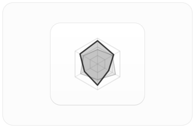
        </picture>
      </a>
      <br />
      <strong>Radar Chart</strong><br />
      <a href="https://ui.bklit.com/docs/components/radar-chart">Docs</a> · <a href="https://ui.bklit.com/studio?chart=radar-chart">Studio</a>
    </td>
    <td align="center" valign="top" width="33%">
      <a href="https://ui.bklit.com/docs/components/ring-chart">
        <picture>
          <source media="(prefers-color-scheme: dark)" srcset="apps/web/public/readme/ring-chart-dark.svg" />
          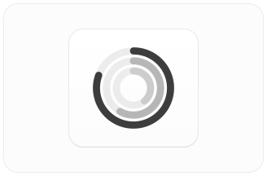
        </picture>
      </a>
      <br />
      <strong>Ring Chart</strong><br />
      <a href="https://ui.bklit.com/docs/components/ring-chart">Docs</a> · <a href="https://ui.bklit.com/studio?chart=ring-chart">Studio</a>
    </td>
    <td align="center" valign="top" width="33%">
      <a href="https://ui.bklit.com/docs/components/sankey-chart">
        <picture>
          <source media="(prefers-color-scheme: dark)" srcset="apps/web/public/readme/sankey-chart-dark.svg" />
          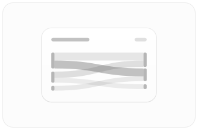
        </picture>
      </a>
      <br />
      <strong>Sankey Chart</strong><br />
      <a href="https://ui.bklit.com/docs/components/sankey-chart">Docs</a> · <a href="https://ui.bklit.com/studio?chart=sankey-chart">Studio</a>
    </td>
  </tr>
  <tr>
    <td align="center" valign="top" width="33%">
      <a href="https://ui.bklit.com/docs/components/scatter-chart">
        <picture>
          <source media="(prefers-color-scheme: dark)" srcset="apps/web/public/readme/scatter-chart-dark.svg" />
          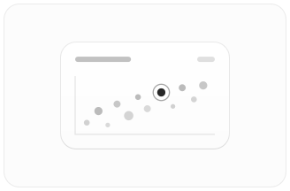
        </picture>
      </a>
      <br />
      <strong>Scatter Chart</strong><br />
      <a href="https://ui.bklit.com/docs/components/scatter-chart">Docs</a> · <a href="https://ui.bklit.com/studio?chart=scatter-chart">Studio</a>
    </td>
    <td align="center" valign="top" width="33%">
      <a href="https://ui.bklit.com/docs/components/sunburst-chart">
        <picture>
          <source media="(prefers-color-scheme: dark)" srcset="apps/web/public/readme/sunburst-chart-dark.svg" />
          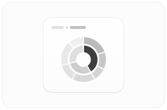
        </picture>
      </a>
      <br />
      <strong>Sunburst Chart</strong><br />
      <a href="https://ui.bklit.com/docs/components/sunburst-chart">Docs</a> · <a href="https://ui.bklit.com/studio?chart=sunburst-chart">Studio</a>
    </td>
    <td width="33%"></td>
  </tr>
</table>

## Studio

Studio is Bklit's interactive chart playground. Pick a chart, tweak styling and animation controls in real time, then copy the generated React code or export a registry JSON for your project.

<p align="center">
  <a href="https://www.youtube.com/watch?v=I3PLqHImYbE"></a>
</p>

[Open Studio →](https://ui.bklit.com/studio)

## Getting Started

Bklit UI is a shadcn registry. Initialize shadcn in your project, then add a chart:

```bash
npx shadcn@latest init
npx shadcn@latest add @bklit/line-chart
```

See [Installation](https://ui.bklit.com/docs/installation) for registry setup and all components.

## Repo activity


## License

**Chart components** (`packages/ui`, shadcn registry) are [MIT licensed](./LICENSE).

**Bklit Studio** (`packages/studio`, hosted at [ui.bklit.com/studio](https://ui.bklit.com/studio))
is proprietary. See [LICENSE-STUDIO.md](./LICENSE-STUDIO.md). You may not reuse,
resell, or redistribute Studio without written permission.
